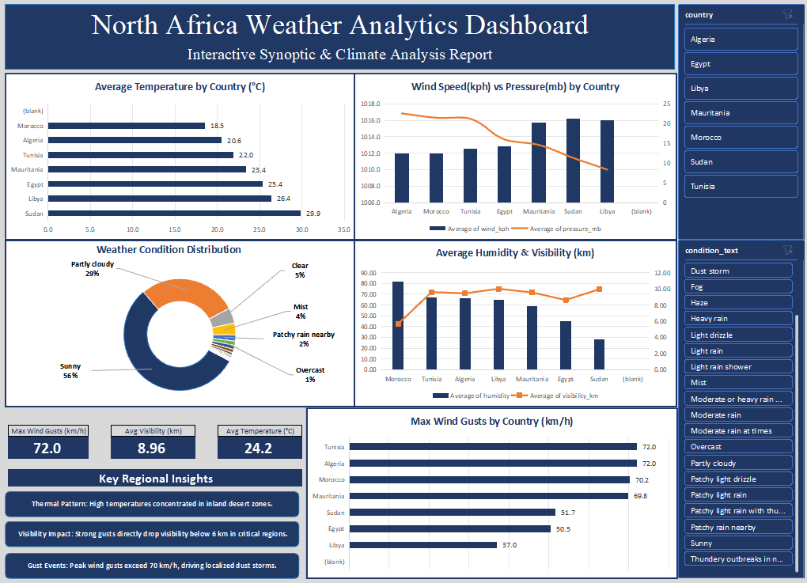

# 🌤️ North Africa Interactive Climate Analytics Dashboard

An executive-level climate analytics dashboard built using **Microsoft Excel** to analyze synoptic weather metrics, aerosol transport patterns, and spatial climate dynamics across North African countries (Egypt, Libya, Sudan, Algeria, Tunisia, Morocco, Mauritania).

---

## 📌 Dashboard Preview



---

## 📊 Project Scope & Dataset Summary

* **Total Records Analyzed:** 5,784 regional weather logs.
* **Core Metrics Tracked:** Average Temperature (°C), Visibility (km), Wind Speed (km/h), Max Wind Gusts (km/h), Atmospheric Pressure (mb), and Relative Humidity (%).
* **Analytical Focus:** Thermal spatial gradients, wind-driven visibility suppression, and synoptic conditions distribution across North Africa.

---

## 📊 Visualizations Breakdown & Synoptic Analysis

### 1. Average Temperature by Country (°C) — [Horizontal Bar Chart]
* **Structure:** Horizontal bar chart ranking North African nations by mean thermal conditions.
* **Synoptic Insight:** Highlights strong continental-desert heating in inland regions (e.g., Sudan averaging 29.9°C, Libya 26.4°C) compared to coastal-moderated Mediterranean/Atlantic zones (Morocco 18.5°C, Tunisia 22.0°C).

### 2. Wind Speed (kph) vs. Pressure (mb) by Country — [Dual-Axis Combo Chart]
* **Structure:** Combo chart tracking average wind speed bars alongside an atmospheric pressure trendline.
* **Synoptic Insight:** Demonstrates classic baroclinic dynamics; lower surface pressures (~1010 mb) strongly correlate with elevated wind speeds, identifying active Saharan low-pressure cyclone tracks.

### 3. Max Wind Gusts by Country (km/h) — [Horizontal Bar Chart]
* **Structure:** Peak gust velocity ranking across regional stations.
* **Synoptic Insight:** Identifies peak wind speeds exceeding 70–72 km/h in Tunisia, Algeria, and Morocco. These high-energy gust events serve as the primary physical driver for dust deflation and mobilization.

### 4. Average Humidity (%) & Visibility (km) — [Dual-Axis Combo Chart]
* **Structure:** Dual-axis chart comparing relative humidity against horizontal visibility distances.
* **Synoptic Insight:** Captures severe visibility degradation (<6 km) during high-dust/gust periods, showcasing the direct impact of airborne dust aerosols on atmospheric clarity across arid zones.

### 5. Weather Condition Distribution — [Donut Chart]
* **Structure:** Categorical breakdown of 5,784 synoptic weather observations.
* **Synoptic Insight:** Reflects the dominant regional climate regime—predominantly Clear/Sunny (56%) and Partly Cloudy (29%), with intermittent dust storms, haze, and localized precipitation events.

---

## 🔑 Key Regional Insights

1. **Thermal Spatial Gradient:** High average temperatures are strongly concentrated in interior desert zones, creating strong local pressure deficits.
2. **Dust Suppression & Visibility Drop:** High wind gust events (>70 km/h) show a direct correlation with sharp drops in horizontal visibility (<6 km).
3. **Synoptic Regime:** Predominance of dry/sunny conditions (~85% combined clear/partly cloudy), with dust and haze events tightly coupled with peak atmospheric gustiness.

---

## 🛠️ Excel Architecture & Technical Features

* **Dynamic KPI Cards:** Custom merged-cell indicators linked dynamically to Pivot aggregates (`72.0 km/h` Peak Gusts, `8.96 km` Avg Visibility, `24.2°C` Avg Temp).
* **Multi-Parameter Slicers:** Synchronized interactive slicers for instant filtering by **Country** and **Weather Condition Text**.
* **UI/UX Polish:** Custom corporate dark-blue palette, zero gridlines, clean single-decimal formatting, and filtered empty `(blank)` categories.

---

## 📁 Repository Structure

```text
├── North_Africa_Climate_Dashboard.xlsx   # Main interactive Excel workbook
├── dashboard_preview.png                  # High-resolution dashboard screenshot
└── README.md                              # Project documentation

---

## 👤 Author & Contact

* **Name:** Ahmed
* **Role:** Meteorological Specialist & Data Analyst
* **Specialization:** Atmospheric Science, Synoptic Analysis & Climate Data Analytics
* **Tools Used:** Microsoft Excel (Pivot Tables, Advanced Charting, Dynamic Slicers, KPI Logic)
* **GitHub Profile:** (https://github.com/ahmedhussein-meteodata) 
* **Kaggle Profile:** [https://www.kaggle.com/ahmedhussein77731]
* **LinkedIn Profile:** [www.linkedin.com/in/ahmed-hussein-meteodata]

